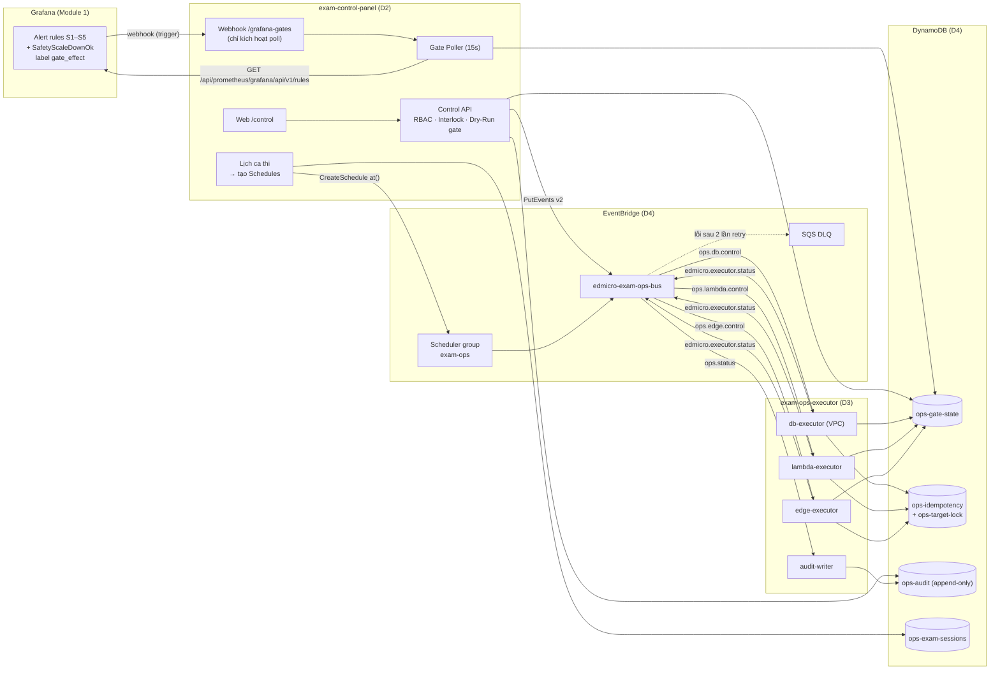

# Engineering Plan v2 — Module 3: Bảng Điều Khiển `/control` & AWS EventBridge Control Plane

> **Thay thế:** `docs/plans/2026-11-15-gitnexus-plan-module-three-eventbridge-control.md` (v1).
> **Lý do sửa:** review `plan-reviews/2026-11-26-review-module-three-eventbridge-control.md` (5 Blocker, 8 Major, 10 Minor).
> **Nguồn đối chiếu:** repo `devsecops/live-exam-noc`, commit `6518515`. Các trích dẫn dưới đây theo đường dẫn và số dòng **hiện tại** của repo.
> **Các quyết định đánh dấu `[CHỐT-ĐỀ XUẤT]`** là phương án khuyến nghị cho 6 câu hỏi còn mở. Cần Tech Lead/SA xác nhận trước khi bắt đầu Giai đoạn 2.

## 1. Mục tiêu

Module 3 cung cấp **đường điều khiển duy nhất** cho hạ tầng kỳ thi (MongoDB Atlas, AWS Lambda, EC2 ASG, ALB, Cloudflare). Đường điều khiển này phải:

1. **An toàn ngay cả khi người bấm, Scheduler hoặc EventBridge mắc lỗi.** Các chốt an toàn nằm ở **hai lớp**: `/control` (để phản hồi ngay cho người dùng) và Executor (để chặn thật). Lệnh từ Scheduler cũng phải qua chốt.
2. **Không chạy trùng** dù EventBridge giao sự kiện theo cơ chế at-least-once.
3. **Lấy trạng thái an toàn từ một nguồn duy nhất** là trạng thái alert rule của Grafana. Ngưỡng S1–S5 không được định nghĩa lại trong code.
4. **Truy vết được 180 ngày** qua Audit Log chỉ thêm, không sửa.

Ngoài phạm vi: thu thập và vẽ metrics (Module 1, 2), hạ tầng Grafana/ALB/SSO và Terraform (Module 4, Team DevSecOps).

## 2. Ranh giới repo và trách nhiệm *(xử lý B1)*

Theo RACI của `docs/plans/2026-11-15-gitnexus-plan-cross-module-architecture-specs.md` (§1, §3.3 dòng 109–127):

| Deliverable | Repo | Team chịu trách nhiệm (R) | Nội dung |
| :--- | :--- | :--- | :--- |
| **D1. Specs Module 3** | `live-exam-noc` (repo này) | SA | `docs/specs/control-panel-rbac-interlock-spec.md`, `grafana-gate-sync-contract.md`, `eventbridge-control-executor-contract.md`: hợp đồng, bảng interlock, schema |
| **D2. Control Panel** (UI + API) | **`exam-control-panel`** *(repo mới)* | Team Lambda (backend), DevSecOps (hosting, SSO, WAF) | Web `/control`, Control API, Gate Poller, Interlock, EventBridge producer, quản lý lịch ca thi |
| **D3. External Executor Service** | **`exam-ops-executor`** *(repo mới)* | Team Lambda | 3 executor (db, lambda, edge), sổ idempotency, kiểm tra lại interlock, dry-run diff, gửi status callback |
| **D4. Hạ tầng** | Repo Terraform của DevSecOps | DevSecOps | Bus, Rules, DLQ, Scheduler group và role, các bảng DynamoDB, IAM, Secrets. Đầu vào là **file yêu cầu tài nguyên** từ D2 và D3 |

- **Repo `live-exam-noc` không chứa code runtime.** Thư mục `control/` trong plan v1 bị bỏ.
- **Không còn `scheduler_presets.py`.** Lịch được sinh động từ lịch ca thi (§6.5). Terraform chỉ tạo *schedule group* và IAM role.

## 3. Hiện trạng

- Mới có giao diện mô phỏng Tab 3 tại `demo/monitor-demo.html:1025–1200` (panel), `:1573–1577` (audit mẫu), `:1898–1945` (định nghĩa nút), `:1990–2040` (dialog và payload).
- Đặc tả nằm ở `docs/specs/2026-11-12-spec-monitoring-overview-dashboard.md`: §6.2 định tuyến và payload (dòng 297–325), §7.1 RBAC (331–336), §7.3 Interlock (365–371), §9.1 Audit 180 ngày (406).
- Demo đang lệch spec ở nhiều điểm: Dry-Run mặc định tắt, `Source`/`DetailType` sai, L1 bấm được nút hạ tầng. Bản vá kèm theo ở `plan-reviews/demo-patch/`.

## 4. Kiến trúc



**Nguyên tắc:**
- **Control API không có quyền hạ tầng.** Nó chỉ có `events:PutEvents`, `scheduler:Create/DeleteSchedule` trong group `exam-ops`, đọc/ghi các bảng `ops-*`, và gọi API đọc của Grafana. Mọi lệnh đọc/ghi hạ tầng, kể cả tính diff cho Dry-Run, đều do Executor làm.
- **Executor không tin `/control`.** Executor đọc `ops-gate-state` và tự đánh giá lại các chốt cứng.

## 5. Hợp đồng dữ liệu

### 5.1. `PutEvents` v2 *(xử lý M1, M3)*

```json
{
  "Source": "edmicro.monitor.control",
  "EventBusName": "edmicro-exam-ops-bus",
  "DetailType": "asg.capacity.update",
  "Detail": {
    "schema_version": "2.0",
    "action_id": "act-20261215-0007",
    "parent_action_id": "act-20261215-0005",
    "idempotency_key": "man:act-20261215-0007",
    "idempotency_ttl_sec": 86400,
    "expires_at_utc": "2026-12-15T12:22:05Z",
    "dry_run": false,
    "dry_run_ref": "act-20261215-0006",
    "requested_by": "sre-oncall@edmicro.vn",
    "role": "DEVOPS_SRE",
    "approvers": [],
    "origin": "manual",
    "target": { "kind": "asg", "id": "api-elb" },
    "parameters": { "desired_capacity": 60, "max_size": 70 },
    "reason": "S5: ALB latency > 2s, DB Xanh",
    "safety_gate_snapshot": { "scaling": "GREEN", "observed_at_utc": "2026-12-15T12:20:01Z", "rev": 4412 },
    "requested_at_utc": "2026-12-15T12:20:05Z"
  }
}
```

**Quy tắc:**
- `origin` nhận `manual` hoặc `schedule`.
- **Lệnh từ Scheduler:** `idempotency_key = "sched:<session_id>:<step>:<target>"` (cố định). `requested_by = "scheduler"`, `role = "SYSTEM_SCHEDULER"`.
- **`expires_at_utc`:** lệnh cứu hộ là `requested_at + 120s`, lệnh scale là `+ 300s`, lệnh lịch là `thời điểm chạy + 600s`.
- **`dry_run_ref`:** bắt buộc với lệnh live do người bấm. Phải trỏ tới một Dry-Run `SUCCEEDED` trong 10 phút gần nhất, có cùng `DetailType`, `target` và `sha256(parameters)`.

### 5.2. Ánh xạ `detail-type` → Rule → Executor → IAM

| Rule (khớp theo `prefix` của `detail-type`) | `detail-type` | Executor | IAM role (D4) |
| :--- | :--- | :--- | :--- |
| `ops.db.control` | `atlas.tier.scale`, `atlas.iops.update`, `atlas.rolling_status.check`, `atlas.ops.kill_slow_queries`, `atlas.rs.step_down` | `db-executor` (trong VPC) | `ops-exec-db`: chỉ Secrets cho Atlas key, không có IAM hạ tầng |
| `ops.lambda.control` | `lambda.concurrency.set_reserved`, `lambda.concurrency.set_provisioned`, `lambda.circuit_breaker.mute_event_monitor` | `lambda-executor` | `ops-exec-lambda`: `PutFunctionConcurrency`, `PutProvisionedConcurrencyConfig`, `DeleteProvisionedConcurrencyConfig`, `Get*` **chỉ trên 3 ARN** |
| `ops.edge.control` | `asg.capacity.update`, `asg.scale_in.suspend`, `asg.scale_in.resume`, `alb.maintenance_503.toggle`, `cloudflare.waiting_room.toggle` | `edge-executor` | `ops-exec-edge`: `SetDesiredCapacity`, `UpdateAutoScalingGroup`, `Suspend/ResumeProcesses` (tag `exam-asg`), `elasticloadbalancing:ModifyRule` (1 listener), Secrets cho Cloudflare |
| `ops.status` | `executor.action.status` (source `edmicro.executor.status`) | `audit-writer` | `ops-audit-writer`: `dynamodb:PutItem` trên `ops-audit` |

- **Bỏ Rule `ops.preset.apply`.** Preset được `/control` tách thành nhiều lệnh con (§6.4).
- **Đổi tên `ops.ec2.asg.control` thành `ops.edge.control`.** Rule này gom cả ASG, ALB và Cloudflare. Module 4 cần cập nhật `eventbridge_control.tf`.
- **Mọi role:** Explicit Deny `*Delete*` (trừ `DeleteProvisionedConcurrencyConfig`) và `*Terminate*`.

### 5.3. Status callback và trạng thái lệnh

`state` ∈ `REQUESTED(10) → DRY_RUN_OK(15) | DISPATCHED(20) → RUNNING(30) → SUCCEEDED(90) | SUCCEEDED_NOOP(90) | SKIPPED_DUPLICATE(80) | REJECTED_INTERLOCK(85) | SKIPPED_GATE_NOT_MET(85) | EXPIRED_STALE(85) | FAILED(95) | AMBIGUOUS_MANUAL_CHECK(99)`

- Số trong ngoặc là `state_rank`. Trạng thái hiện tại của một lệnh là bản ghi có `state_rank` lớn nhất, nhờ đó không bị lỗi khi callback đến sai thứ tự.
- Mọi bản ghi kèm `sequence_no` tăng dần theo `action_id`.

### 5.4. Bảng DynamoDB (D4 tạo, D2/D3 dùng)

| Bảng | Khóa | Ghi chú |
| :--- | :--- | :--- |
| `ops-gate-state` | PK `gate` (`scaling`, `scale_down`, `exam_window`) | `state`, `observed_at_utc`, `source_rev`, `firing_rules[]`. Bên ghi duy nhất là Gate Poller |
| `ops-idempotency` | PK `idempotency_key` | `status`, `lease_until`, `owner`, `result`; TTL bằng `idempotency_ttl_sec` |
| `ops-target-lock` | PK `target_id` (ví dụ `asg:api-elb`) | Khóa mutex theo target, `lease_until` 60s |
| `ops-audit` | PK `action_id`, SK `<state_rank:02d>#<sequence_no:06d>` | Chỉ thêm. GSI `day` + `ts` để liệt kê. TTL 180 ngày. Bật PITR |
| `ops-exam-sessions` | PK `session_id` | `date`, `scale_profile`, `t_start`, `p1`, `p2`, `submit_deadline`, `hard_end` (mặc định 21:45 VN), `status` |

## 6. Thiết kế chi tiết

### 6.1. Gate Sync *(xử lý B3, B4, M7, M8)*

**Nguồn sự thật duy nhất là trạng thái alert rule của Grafana.** `/control` không tự tính ngưỡng.

- **Yêu cầu với Module 1.** Mỗi alert rule ảnh hưởng gate mang label:
  - `gate=scaling` và `gate_effect=red|yellow` cho S1, S2 (`cluster-exam`) và S3 (`Cluster1`).
  - `gate=scale_down` cho rule **`SafetyScaleDownOk`**. Rule này *firing khi an toàn*, gồm 4 điều kiện Atlas `IDLE`, CPU < 25%, Dirty Cache < 15%, SQS `event-monitor` = 0, với `for: 15m` để thể hiện cooldown 15 phút.
  - Cấu hình `noDataState` và `execErrState = Alerting` cho rule `gate_effect=red`.
- **Gate Poller** chạy trong D2:
  - Mỗi 15s gọi `GET /api/prometheus/grafana/api/v1/rules` bằng Service Account token chỉ đọc.
  - Lọc theo label `gate` và quy đổi:

| Điều kiện | `scaling` |
| :--- | :--- |
| Gọi API lỗi, hoặc lần thành công cuối quá **90s** (`gate_ttl_sec`), hoặc có rule `gate` mà `lastEvaluation` quá 90s, hoặc health `nodata`/`error` | `UNKNOWN` |
| Có rule `gate_effect=red` đang `firing` | `RED` |
| Có rule `gate_effect=red` đang `pending`, hoặc `gate_effect=yellow` đang `firing` | `YELLOW` |
| Còn lại | `GREEN` |

  - `scale_down = OK` chỉ khi đồng thời: `SafetyScaleDownOk` đang `firing`, thời điểm hiện tại ≥ `hard_end` của ca, và `scaling ≠ UNKNOWN`. Ngược lại là `LOCK`.
  - `exam_window = ACTIVE` khi thời điểm hiện tại nằm trong `[t_start − 60 phút, hard_end]` của bất kỳ ca nào ở trạng thái `SCHEDULED/RUNNING`.
- **Webhook `POST /api/v1/webhooks/grafana-gates` chỉ là tín hiệu kích hoạt.** Khi nhận được, server **poll ngay lập tức** và bỏ qua nội dung payload. Nhờ vậy:
  - Không có khóa nhầm khi lâu không có alert, vì độ tươi đo theo lần poll thành công.
  - Payload giả mạo không thay đổi được gate. Xác thực chỉ cần header `Authorization` (Grafana webhook hỗ trợ sẵn `authorization_scheme/credentials`), giới hạn nguồn ở SG/VPC và rate limit 1 lần/giây.
  - Cần **sửa `grafana-gate-sync-contract.md`**: bỏ yêu cầu HMAC và ghi rõ webhook chỉ là tín hiệu kích hoạt.
- Ngưỡng cũ 30s/60s **bị bỏ**. Chỉ còn `poll_interval = 15s` và `gate_ttl_sec = 90s`.

### 6.2. RBAC *(xử lý B2)*

Role lấy **chỉ từ claim `cognito:groups`** trong JWT do ALB OIDC chuyển xuống (header `x-amzn-oidc-data`, kiểm tra chữ ký). `[CHỐT-ĐỀ XUẤT]` IdP là Cognito User Pool liên kết Google Workspace, đúng hướng Module 4.

| Role | Được phép | Không được phép |
| :--- | :--- | :--- |
| `EXAM_DUTY_OPERATOR` (L1) | `ack`, `mute`, `copy_notice`, `request_sop(S1..S5)` | **Mọi** `detail-type` trên bus, kể cả circuit breaker, waiting room và preset (trả 403) |
| `DEVOPS_SRE` (L2) | Mọi `detail-type`, tùy theo Interlock (§6.3) | |
| `SYSTEM_SCHEDULER` | Chỉ các `detail-type` trong lịch ca thi | Không gọi được qua HTTP |

`request_sop` **không gửi lên bus**. Control API gửi Slack/Pager cho L2 kèm link `/control?prefill=<sop>`, mở sẵn Dry-Run tương ứng, rồi ghi audit `REQUESTED`.

### 6.3. Bảng Interlock *(xử lý M5, B4)*

Bảng này được áp dụng **giống hệt** ở Control API (trả 409 kèm lý do) và Executor (trả `REJECTED_INTERLOCK`). Bảng nằm trong file `interlock-policy.yaml` và có test hợp đồng chung cho cả hai repo.

| `detail-type` | `GREEN` | `YELLOW` | `RED` | `UNKNOWN` | Trong `exam_window` | Giới hạn cứng |
| :--- | :-: | :-: | :-: | :-: | :--- | :--- |
| `atlas.tier.scale` (lên) | ✔ | ✔ | ✔ | ✔ | **409**, trừ `EMERGENCY_OVERRIDE` | Tier ≤ `M60` |
| `atlas.tier.scale` (xuống) | `scale_down=OK` | 409 | 409 | 409 | **409** | |
| `atlas.iops.update` | ✔ | ✔ | ✔ | ✔ | **409**, trừ `EMERGENCY_OVERRIDE` | |
| `atlas.rolling_status.check` | ✔ | ✔ | ✔ | ✔ | ✔ | Chỉ đọc |
| `atlas.ops.kill_slow_queries` | ✔ | ✔ | ✔ | ✔ (cứu hộ) | ✔ | `secs_running ≥ 5`, chỉ `cluster-exam`, chỉ op `query/getmore` của user app |
| `atlas.rs.step_down` | ✔ | ✔ | ✔ | ✔ (cứu hộ) | ✔ | Tối đa 1 lần mỗi 10 phút mỗi cluster |
| `lambda.concurrency.set_reserved` (tăng) | ✔ | ✔ | 409 | 409 | ✔ | `examination-lambda ≤ 3.000`, `oauth ≤ 500` |
| `lambda.concurrency.set_reserved` (giảm) | ✔ | ✔ | ✔ | ✔ | ✔ | |
| `lambda.concurrency.set_provisioned` (tăng) | ✔ | ✔ | 409 | 409 | ✔ | ≤ 1.200 và ≤ Reserved |
| `lambda.concurrency.set_provisioned` (về 0) | ✔ | ✔ | ✔ | ✔ | ✔ | |
| `lambda.circuit_breaker.mute_event_monitor` | ✔ | ✔ | ✔ | ✔ (cứu hộ) | ✔ | Chỉ nhận giá trị `0` hoặc `50` |
| `asg.capacity.update` (scale out) | ✔ | **409** | 409 | 409 | ✔ | `api-elb ≤ 70`, `oauth ≤ 30` |
| `asg.capacity.update` (scale in) và `asg.scale_in.resume` | `scale_down=OK` | 409 | 409 | 409 | **409** | Mỗi bước giảm ≤ 30%, cách nhau ≥ 10 phút |
| `asg.scale_in.suspend` | ✔ | ✔ | ✔ | ✔ | ✔ | |
| `alb.maintenance_503.toggle` | ✔ | ✔ | ✔ | ✔ (cứu hộ) | ✔ | Chỉ `hoc.edmicro.vn` |
| `cloudflare.waiting_room.toggle` | ✔ | ✔ | ✔ | ✔ (cứu hộ) | ✔ | |

**Các quyết định:**
- **Scale out ASG chỉ khi `GREEN`.** `[CHỐT-ĐỀ XUẤT]` Khớp SOP S5 ("Kiểm tra DB Xanh → `asg.capacity.update`", spec dòng 396) và logic của demo.
- **Tăng Lambda vẫn được ở `YELLOW`.** Lambda có trần cứng nên rủi ro bão kết nối nằm trong tầm kiểm soát. Khi `RED` thì chặn, theo spec §7.3.
- **Mọi lệnh cứu hộ cần 2 bước xác nhận và nhập `reason`.**
- **`EMERGENCY_OVERRIDE`** `[CHỐT-ĐỀ XUẤT]`: cần **2 SRE khác nhau**.
  - Người thứ nhất tạo yêu cầu kèm lý do. Người thứ hai duyệt trong vòng 10 phút.
  - Event mang `approvers: [sre1, sre2]`. Executor kiểm tra có đủ 2 người khác nhau thuộc nhóm `DEVOPS_SRE`.
  - Không được dùng override khi `UNKNOWN`.
  - Lý do: đây chính là thao tác đã gây sự cố 29/10 (`data-2-5.11.2026/plan-exam.md:45-53, 149`).

### 6.4. Preset: tách thành lệnh con *(xử lý M4)*

- Preset là một template lưu trong `presets.yaml` của D2, giá trị lấy từ `BaoCaoSauThi.md:117-124` và spec §8.1.
- **Áp dụng preset:**
  1. Control API sinh `parent_action_id` và N lệnh con, mỗi lệnh có `idempotency_key = "<parent>:<step>"`.
  2. Kiểm tra interlock **từng lệnh**.
  3. Dry-Run hiển thị đủ N thay đổi.
  4. Chỉ khi **tất cả** lệnh con qua được interlock mới gửi đi. Nếu không, trả 409 và liệt kê lệnh con bị chặn.
- Các lệnh con trong cùng miền được gửi theo thứ tự khai báo. Executor dùng `ops-target-lock` nên không chạy chồng.

### 6.5. Lịch ca thi và Scheduler *(xử lý B5, Minor #6)*

- L2 tạo ca thi trên `/control` gồm ngày, `scale_profile` và các mốc giờ. Mặc định theo ca 19:00: `T-4h 15:00`, `T-45p 18:45`, `P1 19:15–19:45`, `P2 20:15–20:45`, `T-10p`, `20:50`, `hard_end 21:45`.
- Control API gọi `scheduler:CreateSchedule` loại **`at()`, chạy một lần** trong group `exam-ops`. Mỗi bước tạo một schedule, target là bus, payload là event v2 với `origin=schedule`.
- **Bổ sung mốc sau 20:50:** `set_provisioned = 0` (spec §6.2).
- **Hạ tải sau 21:45:** tạo 12 schedule cách nhau 5 phút (21:45 → 22:40), cùng gửi lệnh **trạng thái đích**, ví dụ `api-elb desired = 35`.
  - Executor so sánh trạng thái hiện tại với đích: đã đạt thì `SUCCEEDED_NOOP`; `scale_down = LOCK` thì `SKIPPED_GATE_NOT_MET`.
  - Đến 22:40 mà vẫn chưa hạ được thì báo L2.
- Hủy ca thì xóa toàn bộ schedule của ca đó.

### 6.6. Executor *(xử lý B5, M2)*

Thứ tự xử lý mỗi event:

1. **Kiểm tra schema** (`schema_version = 2.0`). Sai thì `FAILED` và ghi lý do.
2. **Kiểm tra hạn:** `now > expires_at_utc` thì `EXPIRED_STALE` và dừng.
3. **Kiểm tra trùng:** `PutItem ops-idempotency` với điều kiện `attribute_not_exists(idempotency_key) OR (status = IN_PROGRESS AND lease_until < now AND idempotent_op = true)`.
   - Bị từ chối và bản ghi đã `SUCCEEDED/FAILED/...` thì `SKIPPED_DUPLICATE`.
   - Lease hết hạn với **lệnh không idempotent** (`kill_slow_queries`, `step_down`) thì `AMBIGUOUS_MANUAL_CHECK`, báo L2 và **không chạy lại**.
4. **Khóa target** `ops-target-lock` (lease 60s). Không lấy được khóa sau 3 lần thử thì `FAILED` (`TARGET_BUSY`).
5. **Kiểm tra lại chốt an toàn:**
   - Đọc `ops-gate-state` và áp `interlock-policy.yaml`. Bản ghi gate quá 90s thì coi là `UNKNOWN`.
   - Kiểm tra giới hạn cứng.
   - Kiểm tra `approvers` nếu lệnh dùng override.
   - Vi phạm thì `REJECTED_INTERLOCK`.
6. **Dry-Run:** đọc trạng thái hiện tại, tính diff, trả `DRY_RUN_OK` kèm `diff`. **Không ghi gì vào hạ tầng.**
7. **Thực thi:** gửi `RUNNING`, gọi API, rồi gửi `SUCCEEDED`, `SUCCEEDED_NOOP` hoặc `FAILED`. Thao tác Atlas scale là bất đồng bộ: executor chỉ gửi yêu cầu, sau đó `atlas.rolling_status.check` theo dõi tiến độ.
8. **Gửi status callback** lên bus, cập nhật `ops-idempotency` và nhả khóa target.

**Cấu hình EventBridge target:** `retry_attempts = 2`, `maximum_event_age = 300s`, có DLQ. `/control` hiện **banner đỏ** khi Grafana alert `DLQ visible > 0` firing (Module 1 cần thêm rule này, label `gate=none`, `banner=dlq`).

### 6.7. Control API (D2)

| Endpoint | Role | Mô tả |
| :--- | :--- | :--- |
| `GET /api/v1/control/state` | L1, L2 | Gate (`scaling`, `scale_down`, `exam_window`, `observed_at`), danh sách action kèm `allowed/locked_reason` theo role và gate, cờ DLQ |
| `POST /api/v1/control/actions` | L2 | Tạo lệnh. `dry_run=true` là mặc định. Live bắt buộc có `dry_run_ref` hợp lệ. Trả `action_id`. Kiểm tra lại gate từ `ops-gate-state` ngay khi gọi |
| `POST /api/v1/control/actions/{id}/approve` | L2 (≠ người tạo) | Duyệt `EMERGENCY_OVERRIDE` |
| `POST /api/v1/control/presets/{name}/apply` | L2 | Tách preset thành lệnh con (§6.4) |
| `POST /api/v1/control/sop-requests` | L1, L2 | `request_sop`, không gửi lên bus |
| `POST /api/v1/control/ack`, `/mute` | L1, L2 | Chỉ ghi audit |
| `GET /api/v1/control/actions/{id}` | L1, L2 | Lịch sử trạng thái (UI poll 2s hoặc SSE) |
| `GET /api/v1/control/audit?day=&cursor=` | L1, L2 | Liệt kê audit 180 ngày |
| `CRUD /api/v1/control/exam-sessions` | L2 | Lịch ca thi và schedule |
| `POST /api/v1/webhooks/grafana-gates` | Grafana | Kích hoạt poll, trả `202` |

### 6.8. Giao diện `/control`

- Chuyển Tab 3 của demo sang Preact + Vite, không có chart.
- **Dry-Run là bước bắt buộc:** nút chính luôn là "Xem trước (Dry-Run)". Nút "Thực thi thật" chỉ hiện sau khi có `DRY_RUN_OK`.
- Dùng `<dialog closedby="closerequest">`, `autofocus` ở nút Hủy, không thêm `role`/`aria-modal`. Với thao tác `CRITICAL`, người dùng phải **gõ lại tên target**.
- Nút hiển thị theo `allowed` từ `/state`. Role **không** chọn được ở client.
- **Không nhúng iframe** trong Grafana: dùng link mở tab mới, đặt header `Content-Security-Policy: frame-ancestors 'none'`. `[CHỐT-ĐỀ XUẤT]` cho câu hỏi mở của Module 2.

### 6.9. Audit *(xử lý M6)*

- Mỗi lần đổi trạng thái là **một bản ghi mới**. Không có `UpdateItem`/`DeleteItem`, và IAM chỉ cấp `PutItem`.
- Bản ghi gồm `ts`, `actor`, `role`, `approvers`, `origin`, `detail_type`, `target`, `parameters_sha256`, `parameters`, `reason`, `state`, `state_rank`, `sequence_no`, `event_id`, `gate_snapshot`, `diff` (với Dry-Run) và `error`.
- TTL 180 ngày, bật PITR. Tùy chọn: dùng DynamoDB Stream xuất sang S3 có Object Lock để chống sửa xóa.

## 7. Trình tự triển khai

| Giai đoạn | Việc | Team | Phụ thuộc |
| :--- | :--- | :--- | :--- |
| **0. Chốt** | Xác nhận 6 mục `[CHỐT-ĐỀ XUẤT]` (§11). Sửa cross-module contract (bỏ HMAC, đổi tên Rule `ops.edge.control`, bỏ `ops.preset.apply`) | SA | — |
| **1. Specs** | Viết 3 spec D1 từ §5, §6 của plan này, kèm `interlock-policy.yaml`, JSON Schema v2 và schema status | SA | 0 |
| **2a. Hạ tầng** | Bus, 4 Rules, DLQ, Scheduler group và role, 5 bảng DynamoDB, 5 IAM role, Secrets | DevSecOps | 1 |
| **2b. Grafana** | Label `gate`/`gate_effect` cho S1–S3, rule `SafetyScaleDownOk` (`for: 15m`), rule DLQ, Service Account token, contact point webhook | Team Grafana | 1 |
| **3. Executor** | Pipeline §6.6 và 3 executor, kèm test (§8) | Team Lambda | 1, 2a |
| **4. Control API** | Gate Poller, RBAC, Interlock, actions/presets/sessions, audit | Team Lambda | 1, 2a, 2b |
| **5. UI** | `/control` (§6.8) | Team Lambda | 4 |
| **6. Tích hợp** | Contract test giữa D2 và D3 với cùng `interlock-policy.yaml`. GameDay S1–S5 ở chế độ Dry-Run rồi Live trên staging | Cả 4 team | 3, 4, 5 |

## 8. Chiến lược test

**D2 (`exam-control-panel`)**
1. `test_gate_quiet_stays_green`: 10 phút không webhook, poll thành công → `GREEN`.
2. `test_gate_unknown_on_poll_failure`: poll lỗi quá 90s, hoặc rule `nodata` → `UNKNOWN`.
3. `test_gate_red_blocks_scale_out_409`: rule S1 `firing` → `asg.capacity.update` (out) và tăng Lambda trả 409.
4. `test_gate_yellow_blocks_asg_allows_lambda`.
5. `test_unknown_allows_rescue_only`.
6. `test_l1_forbidden_all_bus_actions`: mọi `detail-type` và preset trả 403. `request_sop` không gọi `PutEvents`.
7. `test_live_requires_dry_run_ref`: thiếu, quá 10 phút, hoặc khác hash tham số → 422.
8. `test_override_requires_two_distinct_sre`.
9. `test_preset_fanout_all_or_nothing`.
10. `test_webhook_payload_ignored`: payload giả báo "GREEN" khi Grafana đang RED → gate vẫn `RED`.
11. `test_role_only_from_jwt`.
12. `test_session_creates_and_deletes_schedules`, bao gồm mốc 20:50 và 12 lịch hạ tải.

**D3 (`exam-ops-executor`)**
13. `test_duplicate_delivery_runs_once`: chạy cho cả 3 executor.
14. `test_expired_event_rejected`.
15. `test_non_idempotent_lease_expiry_ambiguous`.
16. `test_target_mutex_scheduler_vs_manual`.
17. `test_executor_rechecks_gate`: gate chuyển `RED` sau khi gửi → `REJECTED_INTERLOCK`.
18. `test_hard_caps`: Reserved 3.500, Provisioned 1.500, ASG 80 → bị từ chối.
19. `test_scale_down_desired_state_noop_and_gate_skip`.
20. `test_dry_run_no_writes`: mock SDK, không có lời gọi ghi nào.

**Chung**
21. **Contract test:** cùng bộ fixture `(detail_type, gate, role, window)` → kết quả mong đợi, chạy trên cả D2 và D3.
22. **UI:** kiểm tra a11y của dialog (không `role`/`aria-modal`, có `autofocus` Hủy), `@container (width < 600px)`, không có nút live trước khi Dry-Run.

## 9. Rủi ro

| Rủi ro | Giảm thiểu |
| :--- | :--- |
| Grafana chậm hoặc mất kết nối trong lúc cao điểm | `UNKNOWN` chỉ khóa thao tác scale, lệnh cứu hộ vẫn chạy (§6.3) |
| Bảng interlock ở D2 và D3 lệch nhau | Một file `interlock-policy.yaml` chung (đặt ở D1, D2/D3 vendor theo version) và contract test #21 |
| Gate Poller chết làm gate kẹt ở trạng thái cũ | Executor tự coi bản ghi gate quá 90s là `UNKNOWN` |
| Rate limit Atlas Admin API | `rolling_status.check` poll tối đa 1 lần mỗi 30s. Chỉ executor gọi Atlas |
| Scheduler tạo sai lịch ca | Màn hình xem trước toàn bộ lịch trước khi lưu. Lịch scale lên cũng phải qua interlock ở executor |

## 10. Files / Deliverables

| Nơi | File | Nội dung |
| :--- | :--- | :--- |
| `live-exam-noc` | `docs/specs/control-panel-rbac-interlock-spec.md` | §6.2, §6.3, §6.7, §6.8, §6.9 |
| `live-exam-noc` | `docs/specs/grafana-gate-sync-contract.md` | §6.1 |
| `live-exam-noc` | `docs/specs/eventbridge-control-executor-contract.md` | §5, §6.4–§6.6 |
| `live-exam-noc` | `docs/specs/interlock-policy.yaml`, `docs/specs/schemas/putevents-v2.json`, `executor-status.json` | Nguồn chung cho D2 và D3 |
| `live-exam-noc` | `docs/plans/…module-three…md` | Thay bằng plan v2 này |
| `live-exam-noc` | `demo/monitor-demo.html` | Áp `plan-reviews/demo-patch/monitor-demo.patch` |
| `exam-control-panel` | `app/gate_poller.py`, `app/rbac.py`, `app/interlock.py`, `app/actions.py`, `app/presets.py`, `app/sessions.py`, `app/audit.py`, `web/` | D2 |
| `exam-ops-executor` | `src/pipeline.py`, `src/db_executor.py`, `src/lambda_executor.py`, `src/edge_executor.py`, `src/audit_writer.py` | D3 |
| Repo IaC | `eventbridge_control.tf`, `dynamodb_ops.tf`, `iam_ops.tf` | D4 |

## 11. Quyết định đã chốt theo đề xuất (cần xác nhận)

| # | Câu hỏi trong review | Quyết định đề xuất | Lý do |
| :-: | :--- | :--- | :--- |
| 1 | Ranh giới repo | Theo cross-module: D2 và D3 ở repo riêng, `live-exam-noc` chỉ chứa specs | Đã chốt trong RACI, tránh trộn code vận hành với tài liệu |
| 2 | `EMERGENCY_OVERRIDE` | 2 SRE khác nhau, không dùng được khi `UNKNOWN` | Đúng thao tác gây sự cố 29/10 |
| 3 | Mức chặn scale out | ASG chỉ khi `GREEN`; Lambda chặn ở `RED`/`UNKNOWN` | Khớp SOP S5 và trần cứng của Lambda |
| 4 | Nguồn cửa sổ giờ thi | Bảng `ops-exam-sessions` do L2 nhập trên `/control`; cửa sổ = `[t_start − 60 phút, hard_end]` | Một nguồn duy nhất cho cả interlock và Scheduler |
| 5 | IdP | Cognito liên kết Google Workspace, claim `cognito:groups` | Khớp Module 4 |
| 6 | HMAC webhook | Không cần. Webhook chỉ là tín hiệu kích hoạt, nội dung bị bỏ qua; xác thực bằng `Authorization` header | Gate luôn đọc từ Grafana API nên payload giả không có tác dụng |

## 12. Definition of Done

1. Đủ 3 spec D1 cùng `interlock-policy.yaml` và JSON Schema, được 4 Team Lead ký duyệt.
2. D2 và D3 pass 100% test §8, bao gồm contract test #21 dùng chung fixture.
3. GameDay staging S1–S5: Dry-Run và Live chạy đúng bảng interlock, `DLQ = 0`. Có kịch bản Grafana mất kết nối (`UNKNOWN`) và kịch bản EventBridge giao trùng.
4. Audit có đủ chuỗi trạng thái cho mọi lệnh và không có quyền sửa/xóa bản ghi.
